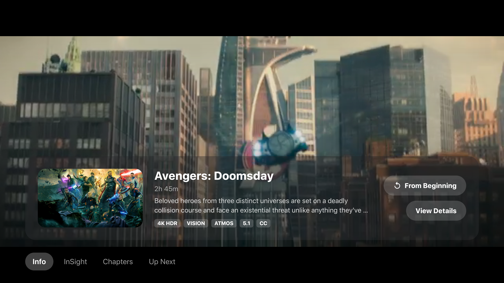

# FlixHub TV

**A cinema-grade Android TV & Google TV streaming experience.**

[Download Latest APK](https://github.com/Arise-in/FlixHUB-Patch/releases/tag/v1.0.0) • [View Changelogs](#-changelogs) • [Previews](#-previews)

---

## Download & Install

<!-- RELEASE_START -->
- **Latest Release:** [`v1.1.1`](https://github.com/Arise-in/FlixHUB-Patch/releases/tag/v1.1.1) • [Download `app-release.apk`](https://github.com/Arise-in/FlixHUB-Patch/releases/download/v1.1.1/app-release.apk)
- **Total Downloads:** **10**
<!-- RELEASE_END -->

1. Download **`app-release.apk`** from the release link above.
2. Install it on your Android TV / Google TV device.
3. Future updates are delivered automatically in-app via **Settings → About → Check for Updates**.

---

## Previews

| Home & Hero Billboard | Title Detail Page |
| :---: | :---: |
|  |  |

| Search & Discovery | Frosted Glass Player HUD |
| :---: | :---: |
|  |  |

---

## Changelogs

<!-- CHANGELOG_START -->
### [`v1.1.1`](https://github.com/Arise-in/FlixHUB-Patch/releases/tag/v1.1.1) — v1.1.1 (2026-11-26) • [Download APK](https://github.com/Arise-in/FlixHUB-Patch/releases/download/v1.1.1/app-release.apk)

Signed FlixHub TV v1.1.1 OTA release (Ed25519 verified).

### [`v1.1.0`](https://github.com/Arise-in/FlixHUB-Patch/releases/tag/v1.1.0) — v1.1.0 (2026-11-26) • [Download APK](https://github.com/Arise-in/FlixHUB-Patch/releases/download/v1.1.0/app-release.apk)

Signed FlixHub TV v1.1.0 OTA release (Ed25519 verified).

### [`v1.0.0`](https://github.com/Arise-in/FlixHUB-Patch/releases/tag/v1.0.0) — FlixHub TV v1.0.0 (2026-11-26) • [Download APK](https://github.com/Arise-in/FlixHUB-Patch/releases/download/v1.0.0/FlixHUB-v1.0.0.apk)

## FlixHub TV `v1.0.0`

Initial production release for **Android TV** and **Google TV** — an **Aniflix** product.

### What's New
- **tvOS-Inspired Frosted Glass UI:** Translucent acrylic panels, Hero Billboard, and unified Home, MovieHUB, AnimeHUB+, Sports, Search, Library, and Settings hubs.
- **60fps D-Pad Navigation:** Pivot-anchored horizontal glide, zero-escape wall locks, and debounced navigation audio (automatically muted inside the video player).
- **Hardware-Accelerated Playback:** Media3 ExoPlayer with multi-audio tracks, playback speed controls, SDH closed captions, and frosted glass HUD drawers.
- **In-App OTA Updater:** Frosted glass update modal with live download progress, SHA-256 verification, and automatic post-install relaunch.

### Checksum (`app-release.apk`)
- **SHA-256:** `807d37eb55552d36cee31f9e27634128078ddfe172b12cb1625ec4d1b7ad0910`

[Full Changelog](CHANGELOG.md)
<!-- CHANGELOG_END -->

---

## Star History

<a href="https://www.star-history.com/#Arise-in/FlixHUB-Patch&Date">
  <picture>
    <source media="(prefers-color-scheme: dark)" srcset="https://api.star-history.com/svg?repos=Arise-in/FlixHUB-Patch&type=Date&theme=dark" />
    <source media="(prefers-color-scheme: light)" srcset="https://api.star-history.com/svg?repos=Arise-in/FlixHUB-Patch&type=Date" />
    
  </picture>
</a>

---

  An <strong>Aniflix</strong> Product • Built for Android TV & Google TV

