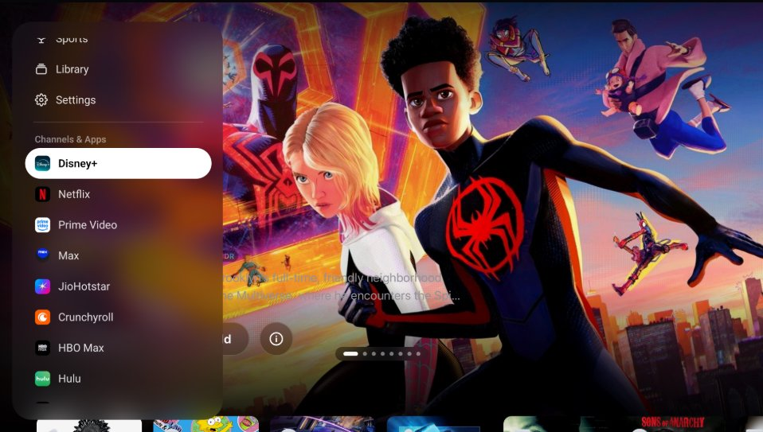
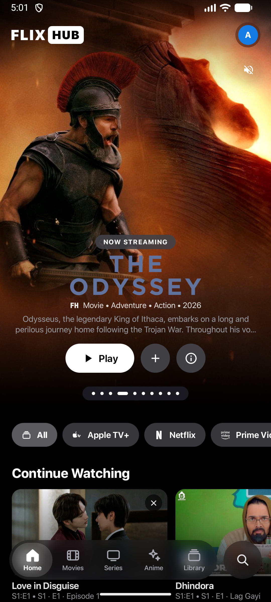
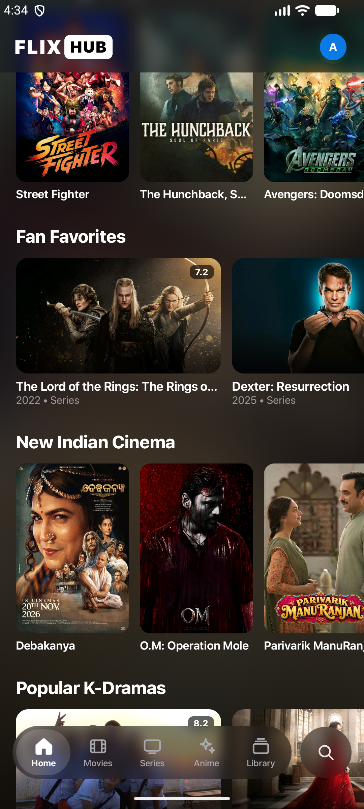
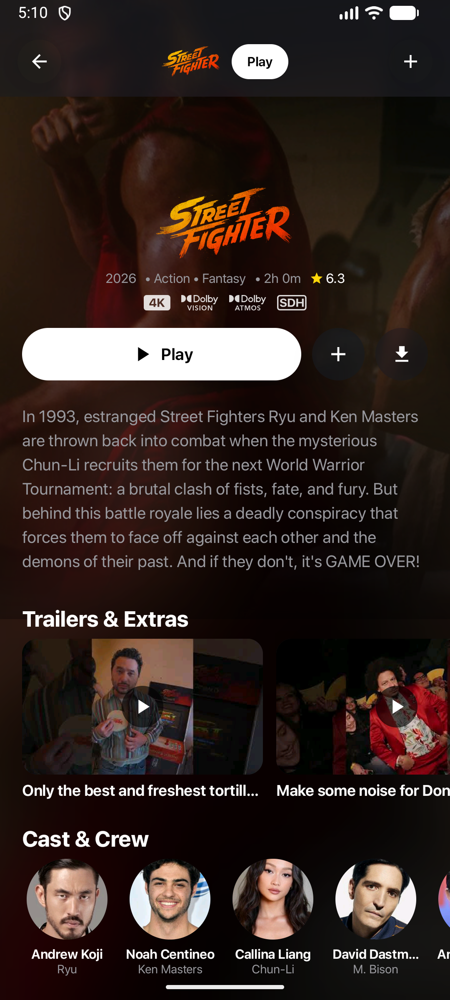
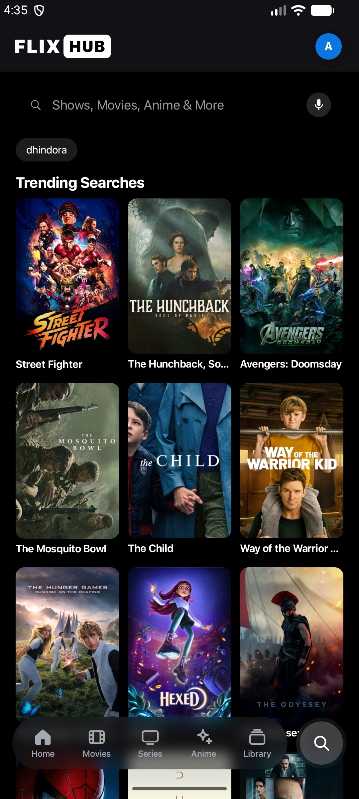
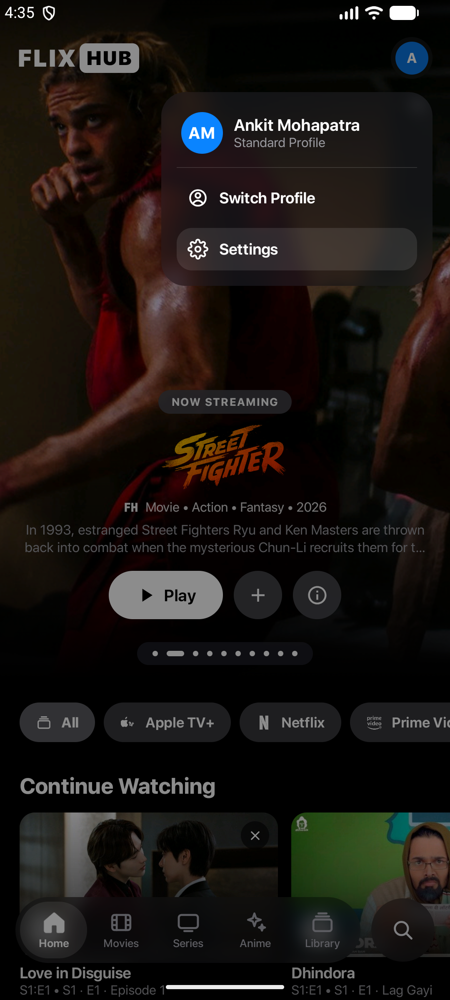

# FlixHUB — TV & Mobile

**Cinema-grade streaming for Android TV, Google TV, and Android Mobile.**

[Download Releases](https://github.com/Arise-in/FlixHUB-Patch/releases) • [Platform Comparison](#-platform-comparison--specs) • [TV Previews](#-android-tv-previews) • [Mobile Previews](#-android-mobile-previews) • [Changelogs](#-changelogs)

---

## Download & Install

<!-- RELEASE_START -->
- **Latest TV Release:** [`v1.4.0`](https://github.com/Arise-in/FlixHUB-Patch/releases/tag/v1.4.0) • [Download `app-release.apk`](https://github.com/Arise-in/FlixHUB-Patch/releases/download/v1.4.0/app-release.apk)
- **Latest Mobile Release:** [`mobile-v1.0.0`](https://github.com/Arise-in/FlixHUB-Patch/releases/tag/mobile-v1.0.0) • [Download `flixhub-mobile-release.apk`](https://github.com/Arise-in/FlixHUB-Patch/releases/download/mobile-v1.0.0/flixhub-mobile-release.apk)
- **Total Downloads:** **94**
<!-- RELEASE_END -->

| Edition | Tag | Version (Build) | Target Devices | APK Size | SHA-256 |
| :--- | :--- | :--- | :--- | :--- | :--- |
| **FlixHUB TV** | [`v1.4.0`](https://github.com/Arise-in/FlixHUB-Patch/releases/tag/v1.4.0) | `1.4.0` (`versionCode 8`) | Android TV / Google TV (`minSdk 24`, `targetSdk 34`) | `12.29 MB` | `5eadeff75e767fd08902a4633097cf507207ab5e97331036e3f49cd709a64a0f` |
| **FlixHUB Mobile** | [`mobile-v1.0.0`](https://github.com/Arise-in/FlixHUB-Patch/releases/tag/mobile-v1.0.0) | `1.0.0` (`versionCode 5`) | Android Phones & Tablets (`minSdk 24`, `targetSdk 34`, 1GB+ RAM tuned) | `11.96 MB` | `4046e58e81e82b651226593ab833c23c935e53cb23e4931225306131dea581e6` |

1. Download the matching APK (**`app-release.apk`** for Android TV / Google TV, or **`flixhub-mobile-release.apk`** for Android Phones).
2. Install on your device (`Settings → Security → Install Unknown Apps`).
3. On Android TV, future updates can also be pulled in-app via **Settings → About → Check for Updates** (Ed25519 signature + SHA-256 verified).

---

## Android TV Previews

| Home & Translucent Sidebar | Title Detail & Extras |
| :---: | :---: |
|  |  |

| D-Pad Search & Provider Filters | Frosted Glass Player HUD |
| :---: | :---: |
|  |  |

---

## Android Mobile Previews

<table>
  <tr>
    <th align="center">Home &amp; Hero Billboard</th>
    <th align="center">Scrolled Blur &amp; Floating Bar</th>
    <th align="center">Detail &amp; Sticky Header Blur</th>
    <th align="center">Search &amp; Discovery</th>
    <th align="center">Frosted Profile &amp; Library</th>
  </tr>
  <tr>
    <td align="center"></td>
    <td align="center"></td>
    <td align="center"></td>
    <td align="center"></td>
    <td align="center"></td>
  </tr>
</table>

---

## Platform Comparison & Specs

| Capability / Architecture | FlixHUB TV (`v1.4.0` Stable) | FlixHUB Mobile (`v1.0.0` Stable) |
| :--- | :--- | :--- |
| **UI Stack** | Kotlin + Jetpack Compose for TV (`androidx.tv`) | Kotlin + Jetpack Compose (`material3`) |
| **Navigation & Input** | 60fps D-Pad pivot scrolling (`BringIntoViewSpec`), wall locks, spring focus scaling (`AppleTvFocusable`), auto-hiding translucent sidebar + Top/Channel hubs | Floating frosted-glass bottom pill bar (`AppleFloatingGlassBottomBar`) with slide-to-switch haptic physics, top glass header, and zero-allocation `ModifierNodeElement` touch bounce |
| **Glass & Ambient Blur** | Real-time Haze `Performance` glass + pre-blurred `FastStackBlurTransformation` ambient backdrops | Real-time Haze `Performance` glass (capped at `12.dp`) + pre-blurred `FastMobileStackBlurTransformation` ambient canvases, automatic low-RAM scrim fallback |
| **1GB RAM & Scroll Tuning** | Leanback focus cache, deferred `800ms+` native trailer extraction (`WebView` disabled), Coil hardware bitmaps | `MobileCardImage` leaf isolation (no scroll-time `ImageRequest` rebuilds), subscriber-counted `BreathingClockRegistry`, bound-cancelled `animateDecay` fling physics, `128MB` / `16MB` low-RAM ExoPlayer cache, ART `baseline.prof` AOT |
| **Media & Streaming Engine** | Media3 ExoPlayer with dual audio tracks, playback speeds, SDH captions, skip-intro, multi-source streams, trailers | Media3 ExoPlayer landscape player (`1.0x–2.0x`, subtitles, audio tracks, InSight, Up Next, Next Episode) + Screenscape/VidNest/YouTube resolution |
| **Offline Library & Storage** | Watchlist, Watch History, external USB drive support, resumable 4K downloads | Persistent Watchlist, Offline Downloads, and Continue Watching / History tabs (`Library`) |
| **Security & Pairing** | Native C++ vault (`libflixcore.so` + AES-256-GCM `core.pak`), QR/Firebase pairing, Ed25519-signed OTA (`manifest.json.sig`) | Native C++ vault (`libflixcore.so` + AES-256-GCM `core.pak`), Firebase Auth & profile switching, V2 signed release with ART AOT profile |

---

## Key Features Across Both Editions

### FlixHUB TV (`v1.4.0` Stable)
- **tvOS-Inspired Cinema Interface:** Pure OLED black (`#000000`) canvas with Haze translucent side drawer, Hero Billboard auto-carousel, Top 10 ranking rows, Watchlist, FlixHUB+, Movies, TV Shows, Anime, Sports, and Provider Hubs.
- **Butter-Smooth 60fps D-Pad Navigation:** Custom focus restoration, horizontal pivot glide, wall locks (`tvWallLock`), and debounced UI navigation audio.
- **External USB & Offline Downloads:** Self-contained offline media storage with 4K multi-audio downloads, pause/resume/cancel controls, and frosted glass Episode/Info dialogs.
- **Signed In-App OTA Updates:** Cryptographically verified via Ed25519 (`manifest.json.sig`) and APK SHA-256 validation before installation.

### FlixHUB Mobile (`v1.0.0` Stable)
- **Floating Liquid-Glass Navigation:** Draggable bottom frosted-glass pill bar (`Home`, `Movies`, `Series`, `Anime`, `Library`, plus glowing `Search` orb) and sticky blurred top headers.
- **Engineered for Smooth Scrolling on 1GB+ RAM:** Eliminates Chromium `WebView` inflation during browsing, offloads ambient blur to pre-blurred `StackBlur` bitmaps, isolates Coil state inside leaf composables, and stops skeleton frame clocks when unmounted.
- **Full Detail & Companion Player:** Parallax hero + trailer autoplay preview, TMDB logos and `4K` / `Dolby Vision` / `Dolby Atmos` / `SDH` badges, Cast & Crew carousels, More Like This recommendations, and full-screen landscape Media3 playback.
- **Unified Account & Profiles:** Seamless Firebase account sign-in, profile switching, Watchlist / History sync, Auto-Play Next Episode, and Auto-Skip Intros toggles.

---

## Changelogs

<!-- CHANGELOG_START -->
### [`v1.4.0`](https://github.com/Arise-in/FlixHUB-Patch/releases/tag/v1.4.0) — FlixHUB TV v1.4.0 Stable (2026-11-28) • [Download `app-release.apk`](https://github.com/Arise-in/FlixHUB-Patch/releases/download/v1.4.0/app-release.apk)

## FlixHUB TV `v1.4.0` Stable

Latest stable release of **FlixHUB TV** for Android TV & Google TV (`versionCode 8`).

### Highlights
- **60fps D-Pad Fluidity:** Pivot-anchored scrolling (`BringIntoViewSpec`), zero-escape wall locks, spring focus scaling, and translucent frosted-glass navigation drawer.
- **Offline 4K & External USB:** Resumable background downloads, external USB removable storage support, Episode & Show Info glass modals, and Media3 ExoPlayer dual-time HUD.
- **Native Vault & Signed OTA:** `libflixcore.so` + AES-256-GCM `core.pak` security vault with Ed25519-verified OTA updates.

### Checksum (`app-release.apk`)
- **SHA-256:** `5eadeff75e767fd08902a4633097cf507207ab5e97331036e3f49cd709a64a0f`

### [`mobile-v1.0.0`](https://github.com/Arise-in/FlixHUB-Patch/releases/tag/mobile-v1.0.0) — FlixHUB Mobile v1.0.0 Stable (2026-11-28) • [Download `flixhub-mobile-release.apk`](https://github.com/Arise-in/FlixHUB-Patch/releases/download/mobile-v1.0.0/flixhub-mobile-release.apk)

## FlixHUB Mobile `v1.0.0` Stable

Initial stable release of **FlixHUB Mobile** for Android phones & tablets (`versionCode 5`).

### Highlights
- **Liquid-Glass UI:** Floating frosted-glass bottom pill bar, glowing search orb, sticky detail header blur, and ambient blurred backdrops (Haze `Performance` mode + pre-blurred StackBlur).
- **1GB+ RAM & Scroll Fluidity:** Eliminates Chromium `WebView` trailer inflation during browsing, isolates image state inside `MobileCardImage`, stops unmounted skeleton clocks, uses `ModifierNodeElement` touch bounce, and ships an ART `baseline.prof` AOT profile.
- **Full Companion Experience:** Home, Movies, Series, Anime, Search, Library (Watchlist / Downloads / History), Profile switching, and Landscape Media3 ExoPlayer.

### Checksum (`flixhub-mobile-release.apk`)
- **SHA-256:** `4046e58e81e82b651226593ab833c23c935e53cb23e4931225306131dea581e6`

### [`v1.3.1`](https://github.com/Arise-in/FlixHUB-Patch/releases/tag/v1.3.1) — FlixHUB TV v1.3.1 (2026-11-27) • [Download `app-release.apk`](https://github.com/Arise-in/FlixHUB-Patch/releases/download/v1.3.1/app-release.apk)

FlixHUB TV v1.3.1 — Login & QR Activation upgrade, 4KHDHub/VidNest streams, Offline Library & Ed25519-signed OTA.

### [`v1.3.0`](https://github.com/Arise-in/FlixHUB-Patch/releases/tag/v1.3.0) — FlixHUB TV v1.3.0 — Login Upgrade & Offline 4K (2026-11-27) • [Download `app-release.apk`](https://github.com/Arise-in/FlixHUB-Patch/releases/download/v1.3.0/app-release.apk)

Login Upgrade, VidNest & Screenscape 4KHDHub/HDHub 4K support, Offline Library & Downloads, and Ed25519-signed OTA.

### [`v1.1.1`](https://github.com/Arise-in/FlixHUB-Patch/releases/tag/v1.1.1) — v1.1.1 (2026-11-26) • [Download `app-release.apk`](https://github.com/Arise-in/FlixHUB-Patch/releases/download/v1.1.1/app-release.apk)

Signed FlixHub TV v1.1.1 OTA release (Ed25519 verified).

### [`v1.1.0`](https://github.com/Arise-in/FlixHUB-Patch/releases/tag/v1.1.0) — v1.1.0 (2026-11-26) • [Download `app-release.apk`](https://github.com/Arise-in/FlixHUB-Patch/releases/download/v1.1.0/app-release.apk)

Signed FlixHub TV v1.1.0 OTA release (Ed25519 verified).

### [`v1.0.0`](https://github.com/Arise-in/FlixHUB-Patch/releases/tag/v1.0.0) — FlixHub TV v1.0.0 (2026-11-26) • [Download `FlixHUB-v1.0.0.apk`](https://github.com/Arise-in/FlixHUB-Patch/releases/download/v1.0.0/FlixHUB-v1.0.0.apk)

## FlixHub TV `v1.0.0`

Initial production release for **Android TV** and **Google TV** — an **Aniflix** product.

### What's New
- **tvOS-Inspired Frosted Glass UI:** Translucent acrylic panels, Hero Billboard, and unified Home, MovieHUB, AnimeHUB+, Sports, Search, Library, and Settings hubs.
- **60fps D-Pad Navigation:** Pivot-anchored horizontal glide, zero-escape wall locks, and debounced navigation audio (automatically muted inside the video player).
- **Hardware-Accelerated Playback:** Media3 ExoPlayer with multi-audio tracks, playback speed controls, SDH closed captions, and frosted glass HUD drawers.
- **In-App OTA Updater:** Frosted glass update modal with live download progress, SHA-256 verification, and automatic post-install relaunch.

### Checksum (`app-release.apk`)
- **SHA-256:** `807d37eb55552d36cee31f9e27634128078ddfe172b12cb1625ec4d1b7ad0910`

[Full Changelog](CHANGELOG.md)
<!-- CHANGELOG_END -->

---

## Star History

<a href="https://www.star-history.com/#Arise-in/FlixHUB-Patch&Date">
  <picture>
    <source media="(prefers-color-scheme: dark)" srcset="https://api.star-history.com/svg?repos=Arise-in/FlixHUB-Patch&type=Date&theme=dark" />
    <source media="(prefers-color-scheme: light)" srcset="https://api.star-history.com/svg?repos=Arise-in/FlixHUB-Patch&type=Date" />
    
  </picture>
</a>

---

  An <strong>Aniflix</strong> Product • Built for Android TV, Google TV &amp; Android Mobile

