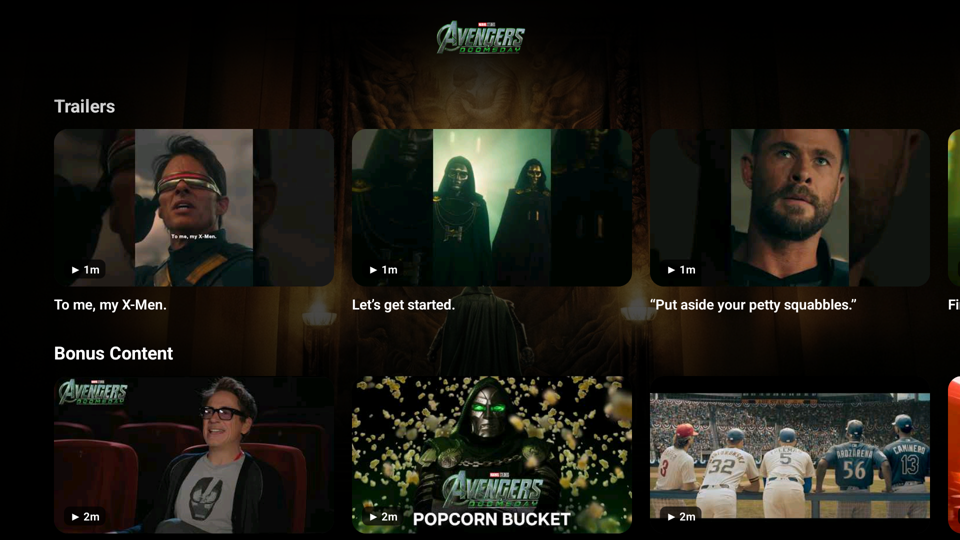
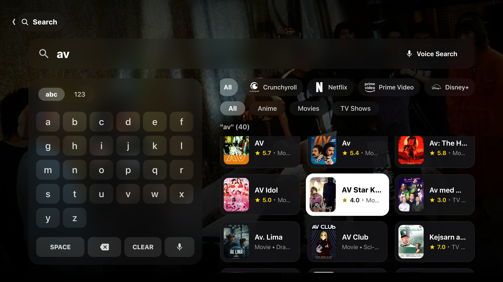

# FlixHub TV

**A cinema-grade Android TV & Google TV streaming experience.**

[Download Latest APK](https://github.com/Arise-in/FlixHUB-Patch/releases/tag/v1.0.0) • [View Changelogs](#-changelogs) • [Previews](#-previews)

---

## Download & Install

<!-- RELEASE_START -->
- **Latest Release:** [`v1.0.0`](https://github.com/Arise-in/FlixHUB-Patch/releases/tag/v1.0.0) • [Download `app-release.apk`](https://github.com/Arise-in/FlixHUB-Patch/releases/download/v1.0.0/FlixHUB-v1.0.0.apk)
- **Total Downloads:** **1**
<!-- RELEASE_END -->

1. Download **`app-release.apk`** from the release link above.
2. Install it on your Android TV / Google TV device.
3. Future updates are delivered automatically in-app via **Settings → About → Check for Updates**.

---

## Previews

| Home & Hero Billboard | Title Detail Page |
| :---: | :---: |
|  |  |

| Search & Discovery | Frosted Glass Player HUD |
| :---: | :---: |
|  |  |

---

## Changelogs

### `v1.0.0` — Initial Android TV Release
- Cinema-grade tvOS-inspired frosted glass UI for Android TV & Google TV
- Smooth 60fps D-Pad navigation with pivot-anchored horizontal glide & zero-escape wall locks
- Hardware-accelerated Media3 ExoPlayer with multi-audio, speed controls & SDH captions
- Built-in in-app OTA update modal with live progress & automatic post-install relaunch

---

## Star History

<a href="https://www.star-history.com/#Arise-in/FlixHUB-Patch&Date">
  <picture>
    <source media="(prefers-color-scheme: dark)" srcset="https://api.star-history.com/svg?repos=Arise-in/FlixHUB-Patch&type=Date&theme=dark" />
    <source media="(prefers-color-scheme: light)" srcset="https://api.star-history.com/svg?repos=Arise-in/FlixHUB-Patch&type=Date" />
    
  </picture>
</a>

---

  An <strong>Aniflix</strong> Product • Built for Android TV & Google TV

